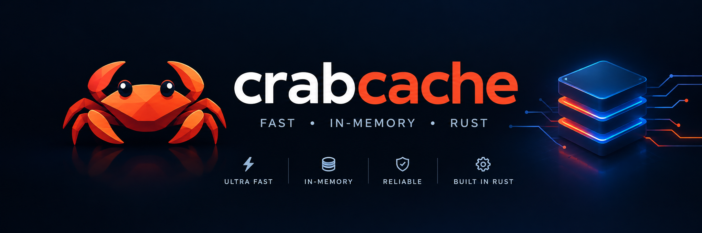

<p align="center">
  
</p>

# crabcache

> A Redis-protocol-compatible in-memory data store, rebuilt from scratch in **Rust**.

[](https://github.com/neoned71/crabcache/actions/workflows/ci.yml)
[](#license)
[](https://www.rust-lang.org/)
[](https://redis.io/docs/reference/protocol-spec/)

`redisrs` is a ground-up Rust rewrite of the [Redis](https://redis.io/) server. It speaks the
Redis Serialization Protocol (RESP2 and RESP3), so **existing Redis clients work unchanged** —
`redis-cli`, `redis-py`, `ioredis`, `go-redis`, `Jedis`, the Rust `redis` crate, and anything
else that talks RESP.

```sh
redis-cli -p 6379 SET hello world
# OK
redis-cli -p 6379 GET hello
# "world"
```

## Why

Redis is one of the most widely deployed pieces of infrastructure on earth (caching, queues,
session stores, leaderboards, pub/sub). The Rust ecosystem has excellent Redis *clients*, but
very few server implementations — and the ones that exist are either toy examples (`mini-redis`),
stale (`reredis`), or brand-new and AGPL-licensed (`KiviDB`). `redisrs` aims to be a clean,
MIT-licensed, well-tested Rust server you can actually run.

## Status

Implements a substantial, production-usable core subset. Think "single-node Redis for the 80% of
workloads" — not yet a full replacement (see [Limitations](#limitations)).

### Data types & commands

| Type | Commands |
|---|---|
| **Strings** | `SET` `GET` `MSET` `MGET` `INCR` `INCRBY` `INCRBYFLOAT` `DECR` `DECRBY` `APPEND` `STRLEN` `GETSET` `GETDEL` `GETEX` `SETNX` `SETEX` `PSETEX` — `SET` supports `EX`/`PX`/`EXAT`/`PXAT`/`NX`/`XX`/`GET`/`KEEPTTL` |
| **Keys** | `DEL` `UNLINK` `EXISTS` `TYPE` `RENAME` `RENAMENX` `KEYS` `SCAN` `RANDOMKEY` `DBSIZE` `FLUSHDB` `FLUSHALL` |
| **TTL** | `EXPIRE` `PEXPIRE` `EXPIREAT` `PEXPIREAT` `TTL` `PTTL` `PERSIST` |
| **Lists** | `LPUSH` `RPUSH` `LPUSHX` `RPUSHX` `LPOP` `RPOP` `LLEN` `LRANGE` `LINDEX` `LSET` `LREM` `LTRIM` |
| **Sets** | `SADD` `SREM` `SMEMBERS` `SCARD` `SISMEMBER` `SPOP` |
| **Hashes** | `HSET` `HGET` `HMGET` `HGETALL` `HDEL` `HEXISTS` `HLEN` `HKEYS` `HVALS` `HINCRBY` |
| **Sorted sets** | `ZADD` `ZREM` `ZSCORE` `ZCARD` `ZRANK` `ZREVRANK` `ZRANGE` `ZREVRANGE` `ZRANGEBYSCORE` `ZREVRANGEBYSCORE` `ZCOUNT` `ZINCRBY` |
| **Pub/Sub** | `PUBLISH` `SUBSCRIBE` `UNSUBSCRIBE` (global broadcast, multi-channel per connection) |
| **Transactions** | `MULTI` `EXEC` `DISCARD` `WATCH` `UNWATCH` |
| **Server / conn** | `PING` `ECHO` `HELLO` `QUIT` `AUTH` `SELECT` `INFO` `CONFIG GET/SET` `CLIENT` `COMMAND` `TIME` `ACL` `SAVE` `BGSAVE` `LASTSAVE` `WAIT` |

### Persistence

- **AOF (append-only file)**: every command is appended to `appendonly.aof`; on startup the file is
  replayed to rebuild state. Enable with `--appendonly`.
- RDB snapshots are not implemented yet (`SAVE`/`BGSAVE` are no-ops).

## Install

### From source (cargo)

```sh
cargo install --git https://github.com/neoned71/crabcache
# or, from a clone:
cargo install --path .
```

### Docker

```sh
docker build -t crabcache .
docker run -p 6379:6379 -v crabcache-data:/data crabcache
```

### From a release binary

Pre-built binaries for macOS/Linux/Windows are published on the
[Releases](https://github.com/neoned71/crabcache/releases) page.

## Quick start

### Build

```sh
git clone https://github.com/neoned71/crabcache
cd crabcache
cargo build --release
```

Requires a recent stable Rust (tested with 1.99). No other system dependencies.

### Run

```sh
./target/release/redisrs \
  --bind 127.0.0.1 \
  --port 6379 \
  --dir ./data \
  --appendonly
```

Then connect with any Redis client:

```sh
redis-cli -p 6379
redis-cli -p 6379 SET user:1 '{"name":"ada"}' EX 3600
redis-cli -p 6379 GET user:1
```

### Configuration (CLI flags)

| Flag | Default | Description |
|---|---|---|
| `--bind` | `127.0.0.1` | Interface to listen on |
| `--port` | `6379` | TCP port |
| `--dir` | `.` | Working directory for persistence files |
| `--dbfilename` | `dump.rdb` | RDB filename (reserved) |
| `--appendonly` | `false` | Enable AOF persistence |

You can also override at runtime via `CONFIG SET dir ...` / `CONFIG SET appendonly ...` (in-memory
only for now).

### Environment

- `RUST_LOG=redisrs=debug` (or `info`, `trace`) for verbose logging.

## Architecture

```
src/
├── main.rs       # CLI, AOF open + replay, bootstrap
├── server.rs     # TCP accept loop, per-connection read/write, broadcast forwarding
├── protocol.rs   # RESP2/RESP3 parser + serializer (Frame enum)
├── commands.rs   # dispatch() — every command as (state, ctx, args) -> Vec<Frame>
├── db.rs         # Db / Entry / DbManager (DashMap-backed, lazy expiry)
└── state.rs      # ServerState, PubSub (global broadcast channel)
```

Key design points:

- **One `DashMap` per database** — lock-free concurrent access, no global mutex on the hot path.
- **Lazy expiry** — expired keys are removed on access; no background sampling yet.
- **Per-connection context** (`ConnContext`) holds selected DB, MULTI queue, subscribed channels,
  auth state, protocol version.
- **Commands are pure-ish functions** returning `Vec<Frame>`, which keeps the protocol layer and
  the logic layer decoupled and testable.
- **AOF is a simple append of the serialized command frame** — replay is just "parse frames, call
  dispatch" in a loop.

## Compatibility with real Redis

Verified with a harness that runs the same command sequence against `redis-server` and `redisrs`
and compares raw RESP bytes.

- ✅ All basic-to-intermediate single-node workloads (cache, counters, lists/sets/hashes/zsets,
  queues, pub/sub, transactions) behave identically.
- ⚠️ `KEYS`/`SMEMBERS`/`HGETALL` iteration order is unspecified and differs (as it does between
  Redis versions).
- ⚠️ Error message wording and a few float-formatting edge cases may differ.
- ❌ Not compatible with: replication, cluster, Lua (`EVAL`), streams, modules, blocking commands
  with timeouts, `SORT`, geo, HyperLogLog, full-text/vector search.

## Limitations

Be honest about what's missing before you point production traffic at it:

- **No replication** — single node only.
- **No cluster mode**.
- **No Lua scripting** (`EVAL`/`EVALSHA`).
- **No streams**.
- **No RDB snapshots** (AOF only).
- **No modules**.
- **No maxmemory eviction** — memory grows unbounded.
- **No active expiry** — only lazy expiry on access.
- **Blocking commands** (`BLPOP`, etc.) are not truly blocking.
- **No TLS**, no Unix sockets, no `--requirepass` enforcement beyond a single password.

## Roadmap

- [ ] True blocking list commands (`BLPOP`/`BRPOP`/`BLMOVE`)
- [ ] RDB dump/load
- [ ] Active expiry sampling + maxmemory policies (LRU/LFU)
- [ ] Lua scripting (`EVAL`)
- [ ] Streams (`XADD`/`XREAD`/…)
- [ ] Master/replica replication (PSYNC)
- [ ] Cluster mode
- [ ] TLS + Unix domain sockets
- [ ] Benchmark suite vs. redis-server

## Testing

There is no in-tree test suite yet (contributions welcome). To validate against real Redis:

1. Start `redis-server` on port `6399` with an empty data dir.
2. Start `redisrs` on port `6400`.
3. Run the same command sequence against both and diff the RESP responses.

A reference script lives in `/tmp/scratchpad/test_compat.py` (not shipped with the repo).

## Contributing

Issues and PRs welcome. Good first contributions:

- Add missing commands (see the roadmap and the `match name` block in `commands.rs`).
- Add unit tests for `protocol::parse` and individual commands.
- Implement blocking list commands.
- Improve AOF (fsync policy, rewrite/compaction).

Please keep new code `rustfmt`-clean and clippy-clean (`cargo clippy -- -D warnings`).

## License

MIT — see [LICENSE](LICENSE). (Intended; license file to be added.)

## Acknowledgements

- [Redis](https://redis.io/) and Salvatore Sanfilippo — for the protocol and the design.
- [Tokio](https://tokio.rs/), [DashMap](https://github.com/xacrimon/dashmap), [bytes](https://github.com/tokio-rs/bytes) — the foundation.
- Inspired by `mini-redis` (Tokio's teaching example) and `reredis`.